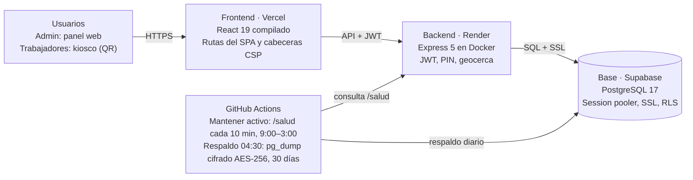

# Documentación técnica — Basel Venue · Control de turnos

Versión: 19-11-2026 · [Versión compartible](https://claude.ai/artifact/TwQL2Zr1HcAPrjf4NkrYPm)

## Contenido

1. [Resumen y arquitectura](#1-resumen-y-arquitectura)
2. [Repositorios y estructura del código](#2-repositorios-y-estructura-del-código)
3. [Stack tecnológico](#3-stack-tecnológico)
4. [Modelo de datos](#4-modelo-de-datos)
5. [Referencia de la API](#5-referencia-de-la-api)
6. [Módulo de asistencia](#6-módulo-de-asistencia)
7. [Seguridad](#7-seguridad)
8. [Configuración](#8-configuración)
9. [Desarrollo local](#9-desarrollo-local)
10. [Pruebas](#10-pruebas)
11. [Despliegue y operación](#11-despliegue-y-operación)
12. [Decisiones técnicas y limitaciones](#12-decisiones-técnicas-y-limitaciones)

## 1. Resumen y arquitectura

El sistema es una aplicación web en tres servicios: el frontend React en Vercel, la API Express en Render y PostgreSQL en Supabase. Gestiona turnos y sueldos del personal de Basel Venue y la asistencia que los trabajadores marcan desde el celular.



Las flechas siguen el sentido de las peticiones: el navegador solo habla con el backend, y solo el backend y las tareas programadas tocan la base de datos.

**Recorrido de una marca de asistencia:**

1. El trabajador abre el kiosco (Vercel) desde el QR y elige su nombre.
2. El navegador obtiene la ubicación y envía PIN, tipo y coordenadas a `POST /kiosco/marcar` (Render).
3. El backend valida PIN, geocerca y estado, y escribe la asistencia en Supabase con la hora del servidor.
4. El panel del administrador la muestra en *En turno ahora* y en el *Historial*.

## 2. Repositorios y estructura del código

El código vive en tres repositorios de GitHub: un repositorio principal que agrupa el backend y el frontend como submódulos de git.

| Repositorio | Contenido | Despliega en |
| --- | --- | --- |
| [control-de-turnos](https://github.com/juanes16122002/control-de-turnos) | Submódulos `backend/` y `frontend/`, `docker-compose.yml`, `docker-compose.local-db.yml`, `vercel.json`, `DESPLIEGUE.md`, `docs/`, logo original | — |
| [control-de-turnos-backend](https://github.com/juanes16122002/control-de-turnos-backend) | API Express | Render |
| [control-de-turnos-front](https://github.com/juanes16122002/control-de-turnos-front) | Aplicación React | Vercel |

**Backend:** capas `routes → controllers → services`; la validación va en middlewares y los errores de negocio se lanzan como `AppError` y los traduce `errorHandler`.

| Carpeta | Contenido |
| --- | --- |
| `server.js` | Arranque: seguridad, CORS, rutas en orden (públicas antes que protegidas), `initDb()` |
| `db.js` | Pool de conexiones y esquema (`initDb()` crea y migra tablas de forma idempotente) |
| `config/` | `asistencia.js` (zona horaria, PIN), `auth.js` (política de sesión), `database.js` (SSL y pool), `proxy.js` (IP real), `tarifas.js` |
| `routes/`, `controllers/`, `services/` | auth, empleados, empresas, turnos, exportaciones, dashboard, kiosco, asistencias, salud, configuración |
| `helpers/` | `tiempo.js` (horas base/extra), `asistencia.js` (fechas, validaciones), `geo.js` (distancia y geocerca) |
| `middlewares/` | `auth` (JWT), `validation` (express-validator), `errorHandler`, `catchAsync` |
| `scripts/` | `migrar-a-supabase.js`, `restaurar-respaldo.sh` |
| `tests/` | Pruebas unitarias (`node --test`) |
| `.github/workflows/` | `mantener-activo.yml`, `respaldo-db.yml` |
| `Dockerfile`, `render.yaml` | Imagen y definición del servicio en Render |

> Importante: los routers protegidos aplican `verificarToken` con `router.use()` a toda petición que pase por ellos, así que las rutas públicas (`kiosco`, `salud`) se montan **antes** en `server.js`.

**Frontend:**

| Ruta | Contenido |
| --- | --- |
| `src/App.js` | Rutas, `PanelLayout` (menú + contenido) dentro de `ProtectedRoute` |
| `src/api.js` | Cliente HTTP con renovación de sesión coordinada entre pestañas |
| `src/kioscoApi.js` | Cliente del kiosco, sin interceptores de sesión |
| `src/components/` | Login, Dashboard, AllTurnos, TurnosTable, TurnoForm, EmpleadosSidebar, BrandLogo, ProtectedRoute |
| `src/components/asistencia/` | Kiosco, panel de asistencia, PINs, ubicación, QR, modales |
| `src/helpers/` | `horas.js` (cálculos), `asistencia.js` (fechas, geolocalización) |
| `src/index.css`, `tailwind.config.js` | Tokens de la marca y componentes de estilo |
| `vercel.json`, `nginx.conf`, `.env.production` | Rutas del SPA, cabeceras de seguridad, build sin scripts en línea |

## 3. Stack tecnológico

JavaScript de punta a punta: Express 5 sobre Node 20 en el backend, React 19 en el frontend y PostgreSQL 17 como base de datos.

| Capa | Tecnología | Versión |
| --- | --- | --- |
| Backend | Node.js (imagen `node:20-alpine`) | 20 |
| Backend | Express | ^5.2.1 |
| Backend | pg (cliente PostgreSQL) | ^8.20.0 |
| Backend | jsonwebtoken / bcryptjs | ^9.0.2 / ^3.0.3 |
| Backend | helmet / cors / express-rate-limit / express-validator | ^8.1.0 / ^2.8.5 / ^8.5.1 / ^7.3.2 |
| Backend | exceljs / pdfkit (exportaciones) | ^4.4.0 / ^0.17.2 |
| Backend | winston / morgan (logs) | ^3.19.0 / ^1.10.1 |
| Frontend | React / React Router | ^19.2.0 / ^7.10.0 |
| Frontend | axios | ^1.13.2 |
| Frontend | Tailwind CSS / lucide-react (íconos) | ^3.4.18 / ^0.555.0 |
| Frontend | qrcode | 1.5.4 |
| Frontend | Create React App (react-scripts) | ^5.0.1 |
| Base de datos | PostgreSQL en Supabase | 17 |
| Infraestructura | Vercel, Render, Supabase, GitHub Actions | — |

## 4. Modelo de datos

Seis tablas en el esquema `public`. No hay migraciones aparte: `initDb()` en `db.js` crea y actualiza el esquema de forma idempotente cada vez que arranca el backend (todos los cambios son aditivos).

| Tabla | Columnas clave | Restricciones e índices |
| --- | --- | --- |
| `empleados` | `id`, `nombre`, `tarifa_hora`, `tarifa_hora_extra` (por defecto 4750), `pin_hash` (bcrypt), `pin_intentos`, `pin_bloqueado_hasta` | PK `id` |
| `empresas` | `id`, `nombre` | PK `id` |
| `turnos` | `empleado_id`, `empresa_id`, `fecha` (DATE), `hora_entrada`/`hora_salida` (TIMESTAMPTZ), `nombre_evento`, `area`, `horas_trabajadas`, `horas_extra`, `valor_horas_extra`, `valor_fijo`, `sueldo_total` | FK empleado `ON DELETE CASCADE`; FK empresa `ON DELETE SET NULL`; los montos se calculan al guardar |
| `asistencias` | `empleado_id`, `entrada`, `salida`, `origen_entrada`/`origen_salida` (`kiosco` o `admin`), `observacion`, `turno_id`, `ubicacion_entrada`/`ubicacion_salida` (JSONB: lat, lng, precision_m, distancia_m) | `CHECK (salida > entrada)`; índice único parcial `ux_asistencias_abierta (empleado_id) WHERE salida IS NULL` (una entrada abierta por persona); índice por `entrada`; FK turno `ON DELETE SET NULL` |
| `configuracion` | `clave` (PK), `valor` (JSONB), `updated_at` | Hoy guarda `geocerca_asistencia` |
| `refresh_tokens` | `token_hash` (SHA-256), `usuario`, `familia` (sesión), `expires_at` (inactividad), `expira_absoluta`, `usado_en`, `reemplazado_por`, `revocado_en` | Índice único por `token_hash`; índice por `familia` |

**RLS:** las seis tablas tienen Row Level Security activado sin políticas. Eso bloquea la Data API pública de Supabase (rol `anon`); el backend se conecta como dueño de las tablas y no se ve afectado.

**Fechas:** los instantes se guardan en `TIMESTAMPTZ` (UTC). El día de una asistencia se calcula en `America/Santiago` (`ZONA_HORARIA`).

## 5. Referencia de la API

API REST en JSON sobre `https://control-de-turnos-backend.onrender.com`. Las rutas protegidas exigen `Authorization: Bearer <token de acceso>`. Los errores responden `{"error": "mensaje"}` con su código HTTP.

**Rutas públicas**

| Método y ruta | Cuerpo / parámetros | Respuesta | Límite |
| --- | --- | --- | --- |
| `GET /` | — | Nombre y versión (health check de Render) | — |
| `GET /salud` | — | `200 {estado, db, ms}` o `503` si la base no responde | 30/min por IP |
| `POST /login` | `usuario`, `contrasena` | `{token, refreshToken}` | 10 cada 15 min por IP |
| `POST /refresh-token` | `refreshToken` | Nuevo par `{token, refreshToken}` | — |
| `POST /logout` | `refreshToken` | Revoca la sesión | — |
| `GET /kiosco/empleados` | — | `[{id, nombre}]` de quienes tienen PIN | — |
| `GET /kiosco/config` | — | `{geocerca_activa}` | — |
| `POST /kiosco/marcar` | `empleado_id`, `pin`, `tipo` (`entrada`/`salida`), `ubicacion?` `{lat, lng, precision_m}` | `{tipo, empleado, asistencia}`; errores 400, 401, 403, 409, 429 | 60/min por IP |

**Rutas protegidas**

| Recurso | Rutas |
| --- | --- |
| Sesión | `GET /perfil` |
| Dashboard | `GET /dashboard` |
| Empleados | `GET`, `POST /empleados` · `GET`, `PUT`, `DELETE /empleados/:id` |
| Empresas | `GET`, `POST /empresas` · `PUT`, `DELETE /empresas/:id` |
| Turnos | `GET /turnos` (`desde`, `hasta`, `empleado_id`, `empresa_id`, `page`, `limit`) · `POST /turnos` · `PUT`, `DELETE /turnos/:id` · `POST /turnos/:id/duplicar` (`fecha`) · `GET /empleados/:id/turnos` (`anio`, `mes`, `empresa_id`, `desde`, `hasta`) |
| Exportaciones | `GET /turnos/excel`, `GET /turnos/pdf` · `GET /empleados/:id/turnos/excel`, `/pdf` |
| PIN | `PUT /empleados/:id/pin` (`pin`, 4–6 dígitos) · `DELETE /empleados/:id/pin` |
| Asistencias | `GET /asistencias` (`desde`, `hasta`, `empleado_id`, `estado`, `page`, `limit`) · `GET /asistencias/activas` · `GET /asistencias/excel` · `POST /asistencias` · `PUT /asistencias/:id` · `POST /asistencias/:id/cerrar` · `POST /asistencias/:id/convertir` (`nombre_evento`, `area`, `empresa_id?`) · `DELETE /asistencias/:id` |
| Geocerca | `GET`, `PUT /configuracion/geocerca` (`activa`, `lat`, `lng`, `radio_m`, `precision_max_m`, `nombre`) |

## 6. Módulo de asistencia

El trabajador marca en el kiosco público con su PIN; el servidor valida PIN, ubicación y estado antes de escribir, y la hora siempre es la del servidor (`NOW()`).

**Orden de validación en `POST /kiosco/marcar`** (`asistencia.service.js`):

1. **PIN** (bcrypt). Empleado inexistente y PIN incorrecto dan el mismo 401, para no revelar cuál falló. Tras 5 fallos (`PIN_MAX_INTENTOS`) se bloquea 15 min (`PIN_BLOQUEO_MINUTOS`) y responde 429.
2. **Geocerca** (`helpers/geo.js`), solo después del PIN: sin PIN válido no se revela la distancia y un rechazo por ubicación no suma intentos. Sin ubicación → 400; precisión peor que `precision_max_m` o distancia (haversine) mayor que `radio_m` → 403.
3. **Escritura:**
    - Entrada: `INSERT`; el índice único parcial convierte una doble entrada, incluso concurrente, en `23505` → 409 con la hora de la entrada abierta.
    - Salida: un `UPDATE … WHERE salida IS NULL AND entrada <= NOW() - 1 min` atómico; sin filas afectadas → 409 (no hay entrada, o pasó menos de un minuto).

Cada marca guarda `ubicacion_entrada`/`ubicacion_salida` con coordenadas, precisión y distancia, para auditoría.

**Conversión a turno** (`convertirEnTurno`): en una transacción, `SELECT … FOR UPDATE` de la asistencia, verifica que esté cerrada y sin turno, crea el turno con el cálculo de sueldo (`turnosService.crear` recibe el cliente de la transacción) y guarda `turno_id`. Si algo falla, `ROLLBACK`: no quedan turnos huérfanos.

**Correcciones del administrador:** marcan `origen_* = 'admin'`, validan que no haya fechas futuras (5 min de tolerancia) y bloquean la edición de asistencias ya convertidas en turno.

**Frontend del kiosco:** usa `kioscoApi.js` sin interceptores (allí un 401 es "PIN incorrecto"), pide la ubicación al elegir a la persona, espera hasta 75 s (arranque en frío de Render) y vuelve al inicio tras 30 s sin actividad.

## 7. Seguridad

La autorización real está en el backend: cada ruta protegida verifica el JWT, y el frontend solo evita mostrar el panel sin una sesión validada.

| Área | Implementación |
| --- | --- |
| Login | Un administrador definido por `ADMIN_USER`/`ADMIN_PASS`; bcrypt con comparación constante; 10 intentos cada 15 min por IP |
| Token de acceso | JWT HS256 de **15 min**; algoritmo fijado al verificar (`algorithms: ['HS256']`) |
| Renovación | Refresh token aleatorio de un solo uso, guardado como **hash SHA-256**, rotado en cada uso dentro de su familia (sesión) |
| Reuso | Usar un refresh token ya rotado fuera del margen de **30 s** revoca toda la sesión; dentro del margen se acepta (pestañas concurrentes) |
| Expiración | Inactividad **12 h** (`REFRESH_IDLE_HOURS`), duración máxima **7 días** (`SESSION_MAX_DAYS`); logout revoca la sesión |
| Varias pestañas | El frontend renueva con la Web Locks API (una pestaña a la vez) y sincroniza el cierre de sesión con el evento `storage` |
| IP real | `trust proxy` automático en Render/Railway; en Render los límites usan `CF-Connecting-IP` (Cloudflare rechaza ese encabezado si lo envía el cliente) con `ipKeyGenerator` |
| CORS | Solo el origen de `CORS_ORIGIN` |
| Cabeceras API | helmet (CSP, HSTS, nosniff, frame options) |
| Cabeceras frontend | CSP estricta (`script-src 'self'`), `X-Frame-Options: DENY`, `Permissions-Policy` (geolocalización solo para el sitio), nosniff, Referrer-Policy (`vercel.json`, `nginx.conf`) |
| Datos | PIN con bcrypt; `pin_hash` nunca se devuelve; RLS en Supabase; errores de la base nunca expuestos al cliente |
| Base de datos | SSL hacia Supabase (`DB_SSL`, verificación con CA opcional) |
| Secretos | Solo en variables de entorno (Render, GitHub Actions); ningún secreto en los repositorios |

## 8. Configuración

Toda la configuración va en variables de entorno; los valores de ejemplo están en `.env.example` (raíz y backend). En producción se definen en Render (backend) y Vercel (frontend).

| Variable | Por defecto | Uso |
| --- | --- | --- |
| `DATABASE_URL` | Postgres local | Supabase → Session pooler (puerto 5432) |
| `JWT_SECRET` | — (obligatoria) | Firma de los tokens de acceso |
| `ADMIN_USER` / `ADMIN_PASS` | `admin` / — (obligatoria) | Credenciales del administrador |
| `CORS_ORIGIN` | `http://localhost:3000` | Origen permitido del frontend |
| `PORT` | 5000 (Render usa 10000) | Puerto HTTP |
| `JWT_EXPIRES_IN` | `15m` | Duración del token de acceso |
| `REFRESH_IDLE_HOURS` / `SESSION_MAX_DAYS` | 12 / 7 | Inactividad y duración máxima de la sesión |
| `DB_POOL_MAX` | 10 (producción: 5) | Conexiones máximas |
| `DB_SSL` / `DB_SSL_CA` / `DB_SSL_CA_PATH` | Automático | `verify` / `require` / `disable`; certificado CA |
| `TRUST_PROXY` | Automático (1 en Render/Railway) | Saltos de proxy de confianza |
| `ZONA_HORARIA` | `America/Santiago` | Día al que pertenece una marca |
| `ORIGEN_DATABASE_URL` | — | Solo para `migrar-a-supabase.js` |
| `REACT_APP_API_URL` (frontend) | `http://localhost:5000` | URL del backend; se fija al compilar |

Secretos de GitHub Actions (repo backend): `RESPALDO_DATABASE_URL`, `RESPALDO_CLAVE`. Variables: `BACKEND_URL`, `KEEPALIVE_INICIO`, `KEEPALIVE_FIN`.

## 9. Desarrollo local

Requisitos: Node 20+, Git y, opcionalmente, Docker o un PostgreSQL local.

```bash
git clone --recurse-submodules https://github.com/juanes16122002/control-de-turnos.git
cd control-de-turnos
cp .env.example .env            # completar valores
```

| Opción | Comando |
| --- | --- |
| Todo con Docker contra Supabase | `docker compose up --build` |
| Todo con Docker y Postgres local | `docker compose -f docker-compose.yml -f docker-compose.local-db.yml up --build` |
| Backend sin Docker | `cd backend && npm install && npm start` (puerto 5000) |
| Frontend sin Docker | `cd frontend && npm install && npm start` (puerto 3000) |
| Migrar datos a otra base | `cd backend && ORIGEN_DATABASE_URL=… npm run migrar:supabase -- --dry-run` |

⚠️ Si `backend/.env` apunta a Supabase, el entorno local escribe en **producción**. Para desarrollar usa la opción con Postgres local.

Flujo de cambios: rama → Pull Request → fusionar en `main` (con *merge commit* en los submódulos) → despliegue automático. Si un cambio toca backend y frontend, se fusionan primero los submódulos y luego se actualizan los punteros en el repo principal.

## 10. Pruebas

El backend tiene 60 pruebas unitarias con el runner nativo de Node (`cd backend && npm test`, es decir, `node --test`).

| Archivo | Cubre |
| --- | --- |
| `sueldo.test.js`, `tiempo.test.js` | Horas base y extra, cruce de medianoche, montos |
| `asistencia.test.js` | Formato de PIN, duraciones, fechas en la zona horaria, validación de rangos |
| `geo.test.js` | Distancia haversine y reglas de la geocerca |
| `database.test.js` | Configuración del pool y SSL (Supabase, CA, `sslmode`) |
| `proxy.test.js` | `trust proxy` y la IP real en Render |
| `salud.test.js` | `/salud`: ok, error sin filtrar detalles, base colgada |

Además, durante el desarrollo se verificaron flujos de punta a punta contra bases temporales y el servidor real: asistencia y geocerca, sesiones (rotación, reuso, concurrencia), varias pestañas en Chrome, límite de intentos detrás de proxy, caída de la base, respaldo y restauración. Esos scripts no están en el repositorio; incorporarlos como pruebas automáticas es trabajo pendiente.

El frontend no tiene pruebas automatizadas; su verificación es `CI=true npm run build` (sin warnings) y revisión en navegador a 320, 390, 768 y 1280 px.

## 11. Despliegue y operación

Todo lo que llega a `main` se publica solo: Vercel compila el frontend y Render construye la imagen Docker del backend. La guía paso a paso está en [`DESPLIEGUE.md`](../DESPLIEGUE.md).

| Pieza | Plataforma | Detalle |
| --- | --- | --- |
| Frontend | Vercel, proyecto `control-de-turnos` (equipo `dev-craft`) | [control-de-turnos-mu.vercel.app](https://control-de-turnos-mu.vercel.app); `REACT_APP_API_URL` en Production y Preview |
| Backend | Render, servicio `control-de-turnos-backend`, plan Free, Oregón | [control-de-turnos-backend.onrender.com](https://control-de-turnos-backend.onrender.com); health check en `/` |
| Base de datos | Supabase, PostgreSQL 17, Session pooler `aws-1-us-west-2` | El esquema se aplica al arrancar el backend |

**Tareas programadas** (GitHub Actions, repo backend):

| Tarea | Cuándo | Qué hace |
| --- | --- | --- |
| `mantener-activo.yml` | Cada 10 min, solo de 9:00 a 3:00 hora de Chile | Consulta `/salud`: evita que Render apague el servicio (se duerme tras 15 min) y genera actividad diaria para que Supabase gratuito no pause el proyecto (~7 días sin uso). Unas 558 h/mes de las 750 gratuitas del workspace, compartidas con otro servicio |
| `respaldo-db.yml` | Diario 07:30 UTC (04:30 Chile) | `pg_dump` 17 del esquema `public`, restauración de prueba con comparación de filas, cifrado AES-256 (GPG) y artifact de 30 días. Si algo falla, falla la tarea y GitHub avisa |

**Restaurar un respaldo:** `bash scripts/restaurar-respaldo.sh <archivo.dump.gpg> "<DATABASE_URL destino>"` descifra, pide confirmación y restaura en una sola transacción.

**Monitoreo:** `GET /salud` responde 503 si la base no contesta; los logs están en Render (winston). Un fallo de cualquiera de las dos tareas llega por correo.

**Volver atrás:** Vercel → *Instant Rollback*; Render → *Rollback* al despliegue anterior. La base no requiere acción porque los cambios de esquema son aditivos.

## 12. Decisiones técnicas y limitaciones

**Decisiones**

| Decisión | Motivo |
| --- | --- |
| `pg` y SQL directo, no `supabase-js` | Transacciones, índices parciales y `AT TIME ZONE` sin una capa extra; Supabase es PostgreSQL estándar |
| Kiosco público con PIN, sin cuentas de trabajador | Marcar sin crear cuentas; menos superficie de seguridad |
| Asistencia separada de turnos, con conversión manual | Una marca errónea no altera la nómina sin revisión |
| Validación de ubicación en el servidor | Saltarse el JavaScript del navegador no evita el control |
| Health check de Render en `/`, no en `/salud` | Si Supabase se pausara, Render no reiniciaría el servicio en bucle |
| Respaldos cifrados en artifacts de GitHub | Gratis y automático; el cifrado es indispensable porque el repo es público |

**Limitaciones conocidas**

- **Plan gratuito de Render:** se duerme entre las 3:00 y las 9:00 sin uso (~1 min para despertar) y comparte 750 h/mes con otro servicio.
- **Plan gratuito de Supabase:** sin respaldos propios ni recuperación a un momento exacto; los respaldos diarios cubren 30 días.
- **Plan Hobby de Vercel:** pensado para uso no comercial; revisar sus términos.
- **Una sola cuenta de administrador:** sin roles ni registro de quién hizo cada cambio.
- **Geocerca disuasiva:** la ubicación del navegador puede falsearse; se registra la distancia de cada marca.
- **Límites de intentos en memoria:** se reinician con cada despliegue y no se comparten si hubiera varias instancias.
- **SSL hacia Supabase sin verificar certificado** hasta configurar `DB_SSL=verify`.

**Trabajo futuro sugerido**

- Cuentas de administrador individuales con roles y auditoría.
- Verificación del certificado SSL de Supabase.
- Llevar las pruebas de punta a punta al repositorio y a un CI.
- Planes pagos (Render, Supabase Pro) si el uso crece o se necesita disponibilidad continua.
